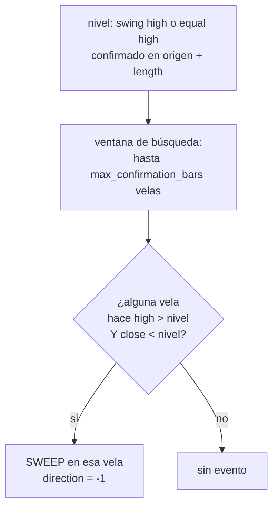

# Liquidez

---

## `liquidity_sweep`

```python
df.smc.liquidity_sweep(
    length: int = 50,
    levels: LiquidityLevels = LiquidityLevels.SWINGS,
    method: EqualLevelMethod = EqualLevelMethod.ATR_PIVOT,
    equal_threshold: float = 0.1,
    atr_period: int = 200,
    tolerance_pct: float = 0.003,
    max_confirmation_bars: int = 50,
) -> pd.DataFrame
```

**Qué hace.** Detecta el patrón de *stop hunt*: una vela cuya **mecha** perfora un
nivel conocido pero cuyo **cierre** vuelve dentro. El precio fue a buscar los stops
acumulados detrás del nivel y regresó.



La distinción con [`bos_choch`](estructura.md#bos_choch) es exactamente esa: si el
cierre **queda fuera** del nivel es una ruptura de estructura; si **vuelve dentro** es
un barrido. Los dos conceptos son mutuamente excluyentes por construcción.

**Requiere.** Lo que requiera el detector de niveles subyacente
(`length * 2 + 1`, o `max(length * 2 + 1, atr_period + 1)` con niveles de tipo
equal-high/low por ATR).

| Parámetro | Tipo | Default | Qué controla |
|---|---|---|---|
| `length` | `int` | `50` | `length` de los pivotes que forman los niveles |
| `levels` | `LiquidityLevels` | `SWINGS` | Qué niveles se vigilan: `"swings"`, `"equal_high_low"` o `"both"` |
| `method` | `EqualLevelMethod` | `ATR_PIVOT` | Solo con niveles equal: cómo se agrupan (ver [`equal_high`](estructura.md#equal_high)) |
| `equal_threshold` | `float` | `0.1` | Solo con `atr_pivot` |
| `atr_period` | `int` | `200` | Solo con `atr_pivot` |
| `tolerance_pct` | `float` | `0.003` | Solo con `pct_range` |
| `max_confirmation_bars` | `int` | `50` | Cuántas velas después de la confirmación se busca el barrido antes de dar el nivel por no barrido |

**Devuelve.** Filas del df en la vela **que barrió** el nivel, más:

| Columna | Tipo | Contenido |
|---|---|---|
| `swept_level` | `float` | Precio del nivel barrido |
| `swept_level_type` | `str` | `"swing_high"`, `"swing_low"`, `"equal_high"` o `"equal_low"` |
| `direction` | `int` | `1` barrido de un mínimo (mecha abajo, sesgo alcista), `-1` barrido de un máximo (mecha arriba, sesgo bajista) |

```python
df.smc.liquidity_sweep(length=50)[
    ["high", "low", "close", "swept_level", "swept_level_type", "direction"]
].head(4)
```

```text
                high      low     close  swept_level swept_level_type  direction
date
2018-06-14   6720.00  6260.00   6635.98       6430.0        swing_low          1
2018-11-14   6482.84  5656.87   5922.41       5880.0        swing_low          1
2020-03-23   6600.00  5688.00   6467.31       6435.0        swing_low          1
2020-09-03  11462.60  9960.80  10140.85      10380.0       swing_high         -1
```

Lee la primera fila: el mínimo de la vela (6260) bajó del swing low en 6430, pero
cerró en 6635.98, por encima. Stop hunt de manual.

## La ventana de búsqueda y el look-ahead bias

Este es el punto delicado del método y conviene entenderlo antes de usarlo en un
backtest.

Un nivel **no existe** hasta que su pivote se confirma, `length` velas después de
haberse formado. Por eso el barrido se busca a partir de `origen + length + 1`, no
desde `origen + 1`:

```text
origen          origen+length        origen+length+k
  │                   │                     │
  ▼                   ▼                     ▼
 pivote          confirmación          ← aquí empieza a buscarse el barrido
(el máximo)     (se sabe que hubo   
                 un máximo)
```

!!! danger "Esto fue un bug real"
    Con niveles equal calculados por proximidad de precio, la búsqueda arrancaba en
    `origen + 1`: se reportaban barridos usando un nivel que el propio algoritmo aún no
    había confirmado en ese momento. Look-ahead bias puro, con test de regresión
    dedicado (`test_liquidity_sweep_equal_high_low_no_lookahead_before_true_confirmation`).

`max_confirmation_bars` es cuánto se sigue vigilando el nivel a partir de ahí. El
default de 50 es generoso; bájalo si solo te interesan los barridos inmediatos.

!!! tip "Un nivel se barre una sola vez"
    En cuanto se encuentra el primer barrido de un nivel, se deja de vigilar. No vas a
    ver el mismo nivel barrido tres veces.

**Notas.**

- Con `levels="both"` se vigilan swings y equal levels a la vez, y `swept_level_type`
  te dice cuál disparó cada fila. Un mismo nivel puede aparecer por las dos vías si
  coincide.
- Los niveles se toman con `include_mitigated=True`: un nivel que el precio ya superó
  con un cierre sigue siendo candidato a barrido en su ventana.
