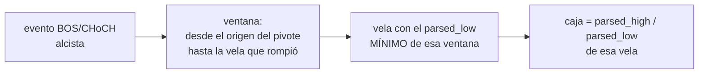

# Zonas

Rangos de precio —no puntos— donde se espera reacción: bloques de orden, huecos de
valor justo y bandas de demanda/oferta. Todos comparten el mismo contrato de caja:
columnas `top` y `bottom` sobre la fila de la vela que origina la zona.

---

## `bullish_order_block`

```python
df.smc.bullish_order_block(
    length: int = 50,
    ob_mitigation: ObMitigation = ObMitigation.HIGH_LOW,
    atr_period: int = 200,
    high_vol_multiplier: float = 2.0,
    volatility_method: VolatilityMethod = VolatilityMethod.ATR,
    confluence_filter: bool = False,
    include_mitigated: bool = False,
) -> pd.DataFrame
```

**Qué hace.** Localiza la vela de la que partió un movimiento alcista que terminó
rompiendo la estructura. La idea de fondo: si el precio despegó desde ahí con fuerza
suficiente para romper un máximo, es probable que quedara órdenes sin ejecutar en esa
zona, y que el precio vuelva a buscarlas.

**Cómo lo hace.**



El paso no obvio es **`parsed_high` / `parsed_low`**: en las velas de volatilidad alta
(rango ≥ `high_vol_multiplier` × ATR) el high y el low se **intercambian** a propósito
antes de buscar el extremo. Es el comportamiento del indicador de referencia: en una
vela de expansión enorme, el extremo relevante para anclar la zona es el opuesto.

**Requiere.** `max(length * 2 + 1, atr_period + 1)` filas.

| Parámetro | Tipo | Default | Qué controla |
|---|---|---|---|
| `length` | `int` | `50` | Ventana de confirmación de los pivotes que generan los eventos |
| `ob_mitigation` | `ObMitigation` | `HIGH_LOW` | Con qué precio se comprueba la mitigación: `"high_low"` (mecha) o `"close"` (cierre) |
| `atr_period` | `int` | `200` | Periodo del ATR que define "vela de alta volatilidad" |
| `high_vol_multiplier` | `float` | `2.0` | Cuántos ATR de rango hacen que una vela cuente como de alta volatilidad |
| `volatility_method` | `VolatilityMethod` | `ATR` | `"atr"` (Wilder) o `"cumulative_mean_range"` (media acumulada del true range) |
| `confluence_filter` | `bool` | `False` | Exigir cuerpo dominante en la vela que rompe (se propaga a `bos_choch`) |
| `include_mitigated` | `bool` | `False` | Incluir los bloques ya mitigados |

**Devuelve.** Filas del df en la vela de origen de cada bloque, más:

| Columna | Tipo | Contenido |
|---|---|---|
| `top` | `float` | Techo de la caja (`parsed_high` de la vela de origen) |
| `bottom` | `float` | Suelo de la caja (`parsed_low` de la vela de origen) |
| `mitigated` | `bool` | `True` si, tras la vela de confirmación, algún `low` (o `close`, según `ob_mitigation`) bajó del `bottom` |

!!! warning "`top`/`bottom` no siempre coinciden con el `high`/`low` de la fila"
    En las velas de alta volatilidad están intercambiados por el paso `parsed_*`. Si
    necesitas el rango crudo de la vela, usa las columnas `high`/`low` originales, que
    siguen presentes en el resultado.

---

## `bearish_order_block`

```python
df.smc.bearish_order_block(...) -> pd.DataFrame
```

Simétrico: parte de eventos BOS/CHoCH **bajistas**, busca el `parsed_high` **máximo**
de la ventana y marca `mitigated=True` cuando un `high` (o `close`) posterior supera el
`top`. Mismos parámetros y mismas columnas.

---

## `order_blocks`

```python
df.smc.order_blocks(
    length: int = 50,
    ob_mitigation: ObMitigation = ObMitigation.HIGH_LOW,
    atr_period: int = 200,
    high_vol_multiplier: float = 2.0,
    volatility_method: VolatilityMethod = VolatilityMethod.ATR,
    confluence_filter: bool = False,
    include_mitigated: bool = False,
    as_records: bool = False,
) -> pd.DataFrame | list[dict]
```

**Qué hace.** Los dos anteriores concatenados y ordenados por índice, con una columna
`direction` que los distingue. Es el método que querrás normalmente.

**Devuelve (DataFrame).** Lo mismo que los individuales, más:

| Columna | Tipo | Contenido |
|---|---|---|
| `direction` | `int` | `1` alcista (demanda), `-1` bajista (oferta) |

```python
df.smc.order_blocks(length=50)[["close", "top", "bottom", "direction", "mitigated"]].head(4)
```

```text
               close       top    bottom  direction  mitigated
date
2019-01-29   3411.04   3443.45   3349.92          1      False
2020-06-27   9012.00   9196.24   8833.00          1      False
2020-09-05  10166.69  10565.68   9825.00          1      False
2022-11-21  15781.29  16319.00  15476.00          1      False
```

**Devuelve (`as_records=True`).**

| Clave | Tipo | Contenido |
|---|---|---|
| `top` / `bottom` | `float` | Bordes de la caja |
| `timestamp` | etiqueta | Vela de origen |
| `bar_index` | `int` | Su posición |
| `direction` | `int` | `1` / `-1` |
| `mitigated` | `bool` | Estado |

!!! note "No hay límite de retención"
    A diferencia del indicador de referencia (que corta arbitrariamente en los 100 más
    recientes), aquí se retienen **todos** los bloques detectados. Si quieres solo los
    N últimos, recorta el resultado tú.

---

## `fair_value_gaps`

```python
df.smc.fair_value_gaps(
    min_gap_atr_multiple: float = 0.0,
    atr_period: int = 200,
    include_filled: bool = False,
    as_records: bool = False,
) -> pd.DataFrame | list[dict]
```

**Qué hace.** Detecta el hueco clásico de 3 velas: un tramo de precio por el que el
mercado pasó tan rápido que ninguna vela intermedia lo negoció. La expectativa es que
el precio vuelva a "rellenarlo".

**Cómo lo hace.** Para un FVG **alcista** en la vela `i`, las tres condiciones son:

```python
low[i] > high[i-2]          # el hueco existe
close[i-1] > high[i-2]      # la vela intermedia cerró por encima del hueco
close[i-1] > open[i-1]      # y además es alcista en su propio cuerpo
```

La caja va de `bottom = high[i-2]` a `top = low[i]`, y ocupa las 3 velas `[i-2, i]`.
El caso bajista es el reflejo con `high[i] < low[i-2]`.

!!! info "La tercera condición no es decorativa"
    Exigir que la vela intermedia tenga **sesgo direccional propio** descarta un falso
    positivo real: una vela que abre con un hueco enorme al alza pero cierra por debajo
    de su apertura (bajista en sí misma) dejaba un "FVG alcista" que la referencia no
    reconoce. Está fijado por un test de regresión.

**Requiere.** 3 filas, o `atr_period + 1` si activas el filtro de tamaño.

| Parámetro | Tipo | Default | Qué controla |
|---|---|---|---|
| `min_gap_atr_multiple` | `float` | `0.0` | Descarta huecos menores que `min_gap_atr_multiple × ATR(atr_period)`. `0.0` = sin filtro |
| `atr_period` | `int` | `200` | Periodo del ATR del filtro de tamaño |
| `include_filled` | `bool` | `False` | Incluir los huecos que el precio ya rellenó |
| `as_records` | `bool` | `False` | Devolver `list[dict]` |

**Devuelve (DataFrame).** Filas del df en la vela de **confirmación** (la tercera del
patrón), más:

| Columna | Tipo | Contenido |
|---|---|---|
| `top` | `float` | Borde superior del hueco |
| `bottom` | `float` | Borde inferior del hueco |
| `direction` | `int` | `1` alcista, `-1` bajista |
| `filled` | `bool` | `True` si el precio volvió a entrar en el hueco después |

```python
df.smc.fair_value_gaps()[["close", "top", "bottom", "direction", "filled"]].head(4)
```

```text
              close      top   bottom  direction  filled
date
2018-12-18  3652.98  3424.47  3294.00          1   False
2019-02-09  3665.18  3625.13  3426.45          1   False
2019-02-18  3898.60  3655.00  3648.20          1   False
2020-03-20  6208.36  5670.00  5436.17          1   False
```

**Devuelve (`as_records=True`).** La versión en registros es la que necesitas para
**dibujar**, porque expone las dos velas del hueco:

| Clave | Tipo | Contenido |
|---|---|---|
| `top` / `bottom` | `float` | Bordes del hueco |
| `direction` | `int` | `1` / `-1` |
| `left_index` | `int` | Posición de la **primera** vela del patrón (`right_index - 2`) |
| `right_index` | `int` | Posición de la vela de confirmación |
| `left_time` / `right_time` | etiquetas | Sus timestamps |
| `filled` | `bool` | Estado |

```text
{'top': 3424.47, 'bottom': 3294.0, 'direction': 1,
 'left_index': 486, 'right_index': 488, 'filled': False,
 'left_time': Timestamp('2018-12-16 00:00:00'),
 'right_time': Timestamp('2018-12-18 00:00:00')}
```

!!! warning "Cambio respecto a versiones previas"
    `left_index` y `left_time` apuntaban antes a la vela de confirmación (el mismo
    valor que `right_index`), así que una caja dibujada con ellos arrancaba 2 velas
    tarde. Desde este cambio apuntan a la primera vela, como indica su nombre. Si tu
    código compensaba ese desfase a mano, quita la compensación.

---

## `demand_zone`

```python
df.smc.demand_zone(
    origin: ZoneOrigin | str = ZoneOrigin.FRACTAL,
    length: int = 5,
    side: ZoneSide | str = ZoneSide.SUPPORT,
    offset_pct: float = 0.5,
    include_mitigated: bool = False,
) -> pd.DataFrame
```

**Qué hace.** Convierte un nivel puntual en una **banda** de reacción, ensanchándolo un
porcentaje. Sirve para no tener que acertar el precio exacto: una zona de 0,5 % alrededor
de un fractal es un objetivo operable, un precio exacto no.

**Requiere.** `length * 2 + 1` filas.

| Parámetro | Tipo | Default | Qué controla |
|---|---|---|---|
| `origin` | `ZoneOrigin` | `FRACTAL` | A qué nivel se ancla la banda. Hoy solo hay fractales |
| `length` | `int` | `5` | `length` del fractal subyacente |
| `side` | `ZoneSide` | `SUPPORT` | `"support"` (demanda, ancla el borde bajo y extiende hacia **abajo**) o `"resistance"` (oferta, ancla el alto y extiende hacia **arriba**) |
| `offset_pct` | `float` | `0.5` | Ancho de la banda como **porcentaje** del precio ancla. `0.5` = 0,5 %, no 50 % |
| `include_mitigated` | `bool` | `False` | Incluir zonas cuyo fractal ya fue atravesado |

**Devuelve.** Las mismas filas y columnas que [`fractal`](estructura.md#fractal)
(incluidas `confirm_time` y `mitigated`), con `top`, `bottom` y `direction`
recalculados como banda:

```python
df.smc.demand_zone(length=5)[["top", "bottom", "direction", "mitigated"]].head(4)
```

```text
                top      bottom  direction  mitigated
date
2017-09-15  2817.00  2802.91500          1      False
2018-12-15  3156.26  3140.47870          1      False
2019-01-29  3349.92  3333.17040          1      False
2019-02-14  3568.11  3550.26945          1      False
```

Con `side="support"`, el `top` de la zona **es** el `bottom` del fractal, y la banda
cuelga por debajo. Con `side="resistance"` es al revés.

!!! note "`mitigated` viene del fractal, no de la banda"
    Refleja si el precio cruzó el nivel **del fractal**, no si tocó el borde exterior
    de la zona. Es una simplificación consciente: una comprobación específica del borde
    de la banda sería un refinamiento futuro.

**Errores.** `side` y `origin` son enums: cualquier otro valor lanza `ValueError`.
`offset_pct` debe ser positivo (un valor negativo producía una banda invertida).
